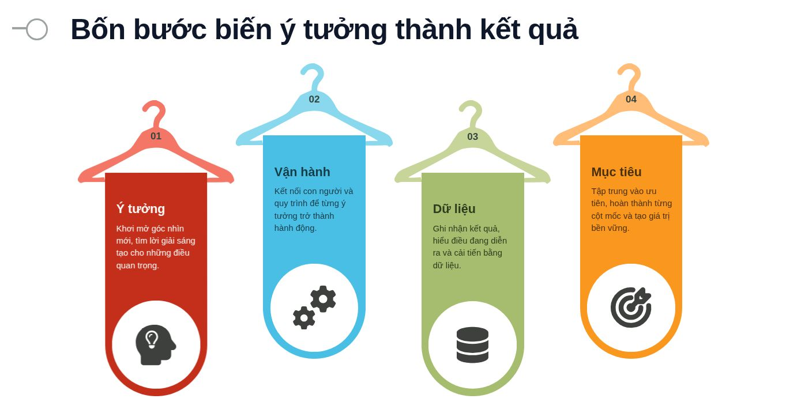

# HB4 — Bốn banner móc treo

HB4 triển khai bố cục “Banners on Hangers” từ ảnh tham chiếu và hai SVG được cung cấp. Bốn cụm móc treo, banner đáy tròn và đĩa icon giữ vị trí **thấp–cao–thấp–cao**. Nội dung tiếng Việt đi theo bốn bước: Ý tưởng → Vận hành → Dữ liệu → Mục tiêu.

Route riêng là `/shapes/hb4-hanger-banners`. Trên trang chủ, `<Hb4HangerBanners />` được nối sau KC3 ở vị trí **33**. Module dùng cùng cách tổ chức component/config/CSS, CSS mask và engine hoạt cảnh của repo.

## Các file cần biết

| File hoặc thư mục | Vai trò |
| --- | --- |
| `src/components/shapes/hb4-hanger-banners/Hb4HangerBanners.tsx` | Ghép các lớp, danh sách bốn nút, chọn và điều hướng bàn phím |
| `src/components/shapes/hb4-hanger-banners/hb4-hanger-banners.config.ts` | Tiêu đề, nội dung dài/ngắn, tọa độ, màu và tên icon |
| `src/components/shapes/hb4-hanger-banners/hb4-hanger-banners.css` | Hình học, nền, mask, chữ, focus, hover và responsive |
| `src/components/shapes/hb4-hanger-banners/Hb4StepIcon.tsx` | Bốn pictogram từ `react-icons` đã có trong dự án |
| `public/assets/shapes/hb4-hanger-banners/` | Ba mask, ảnh tham chiếu, manifest và hai SVG gốc |
| `scripts/generate_hb4_assets.mjs` | Tái tạo mask và manifest từ bản SVG đã lưu |
| `public/shape-auto-animations.js` | Recipe `hb4-hanger-banners` và các chuyển động HB4 |
| `src/app/shapes/hb4-hanger-banners/page.tsx` | Trang riêng và metadata |
| `src/app/page.tsx`, `src/components/shapes/index.ts`, `src/data/shape-registry.ts` | Nối vào trang chủ, export component/config và khai báo tài nguyên |

## Dùng lại đúng hai SVG nguồn

Các file `originals/hb4-source-banner.svg` và `originals/hb4-source-hanger.svg` là bản nguyên byte của `shape 1.svg` và `shape 2.svg`. `manifest.json` lưu tên upload, dung lượng và SHA-256 của từng bản gốc, ảnh tham chiếu và mask xuất ra. Generator kiểm tra hash trước khi xử lý; nếu thay nguồn thì phải đo lại hình học và cập nhật generator có chủ đích.

Ba mask được tách từ **hai** nguồn, không phải ba SVG vẽ lại:

| Mask | Phần tử nguồn | Xử lý |
| --- | --- | --- |
| `hb4-hanger-mask.svg` | `shape 2.svg`, `path[0]` | Giữ nguyên dữ liệu path; crop artboard quanh móc, chừa 0,75 đơn vị mỗi cạnh |
| `hb4-banner-mask.svg` | `shape 1.svg`, `path[1]` | Giữ nguyên path; xoay −90°, cắt bớt phần chữ nhật để đạt tỉ lệ 99:216 |
| `hb4-medallion-mask.svg` | `shape 1.svg`, `circle[0]` | Giữ circle có tâm `(943.7, 1250)`, bán kính `488.3`; crop sát để đặt độc lập ở kích thước 85 × 85 |

Trong `shape 1.svg`, thân banner ban đầu nằm ngang, đầu tròn ở bên trái. SVG này còn có một path móc treo ngoài artboard, ở tọa độ y âm. Generator chỉ lấy path thân đang nhìn thấy và circle; path ngoài artboard vẫn được bảo toàn trong bản gốc nhưng không đi vào mask thân.

Vùng thân gốc có bounds `(355.7, 716.9, 3288.7, 1066.2)`. Chiều cao sau xoay được tính là `1066.2 × 216 / 99 = 2326.254545…`. Phép biến đổi là `matrix(0 -1 1 0 -716.9 2681.954545)` và `viewBox="0 0 1066.2 2326.254545"`. Việc rút chiều dài dùng crop phần thẳng, nên cung tròn đáy không bị kéo dẹt. Móc giữ `viewBox="189.95 176.05 3620.091884 1939.4"`; đĩa icon giữ `viewBox="455.4 761.7 976.6 976.6"`.

Chạy từ thư mục gốc repo:

```sh
node scripts/generate_hb4_assets.mjs
```

Lệnh ghi lại ba mask và `manifest.json`, đọc nguồn trong `originals/` và `hb4-reference.png`; không phụ thuộc thư mục upload ban đầu, công cụ đồ họa bên ngoài hoặc package mới. Khi chỉ sửa màu/nội dung, không cần chạy generator.

## Hình học và thứ tự lớp

Ảnh nguồn có kích thước **735 × 413**; vùng nền tối trong ảnh cao khoảng **380px**. Canvas triển khai là **735 × 400**, có thêm khoảng thở dưới banner và không dựng dải footer của ảnh. `darkStageHeight` trong manifest mô tả ảnh nguồn, không phải chiều cao canvas CSS.

Các tọa độ dưới đây tính bằng pixel trên canvas 735 × 400. CSS đổi chúng thành phần trăm; chiều rộng tối đa là 1.320px, tương ứng chiều cao khoảng 718,37px. Tiêu đề bắt đầu tại `(56, 11)`; dấu vòng tròn trang trí bắt đầu tại `(13, 18)`.

| Cột | Góc trên trái cụm `(x, y)` | Góc trên trái thân `(x, y)` | Đáy thân | Icon |
| --- | --- | --- | --- | --- |
| 01 — Ý tưởng | `(63, 97)` | `(89, 167)` | `383` | Đầu người với bóng đèn |
| 02 — Vận hành | `(216, 61)` | `(242, 131)` | `347` | Hai bánh răng lệch nhau |
| 03 — Dữ liệu | `(369, 97)` | `(395, 167)` | `383` | Cơ sở dữ liệu |
| 04 — Mục tiêu | `(522, 61)` | `(548, 131)` | `347` | Bia và mũi tên |

Khoảng bước ngang giữa các cụm là **153px**; chênh cao là **36px**. Mỗi `.hb4-item` và nút `.hb4-card` chiếm **151 × 286px**. Các số đo bên trong dùng hệ tọa độ cục bộ của cụm hoặc thân:

| Lớp | Tọa độ và kích thước |
| --- | --- |
| Móc `.hb4-hanger` | `(0, 0)`, rộng 151px, cao khoảng 80,894px theo tỉ lệ mask gốc |
| Số `.hb4-number` | Trong cụm: `left: 40%`, `top: 10.4%`, `width: 20%`; căn giữa cổ móc |
| Thân `.hb4-banner` | Trong cụm: `(26, 70)`, **99 × 216px** |
| Khối chữ `.hb4-copy` | Trong thân: trái 11px, trên 28px, phải 10px |
| Đĩa icon `.hb4-medallion` | Trong thân: `(7, 124)`, **85 × 85px**, cách đáy 7px |
| Hộp icon `.hb4-icon` | Trong đĩa: `left/top: 25%`, `width/height: 50%`, tương ứng **42,5 × 42,5px** |

Móc ở `z-index: 1`, số ở `2`, toàn bộ thân ở `3`. Thân phủ qua thanh ngang dưới của móc; không để khoảng hở giữa hai tài nguyên. Màu được vẽ trên `.hb4-hanger`, `.hb4-banner__paint` và `.hb4-medallion__paint` bằng cả `mask` lẫn `-webkit-mask`. Chữ, icon và focus ring là các lớp độc lập, không bị cắt bởi silhouette của mask.

Pictogram Ý tưởng ghép `FaHeadSideVirus` với `FaRegLightbulb`; Vận hành ghép hai `FaGear`; Dữ liệu dùng `FaDatabase`; Mục tiêu dùng `TbTargetArrow`. CSS căn và chỉnh tỉ lệ quang học từng icon. Tất cả đã dùng thư viện `react-icons` của repo.

## Đổi nội dung, màu và tài nguyên

Sửa `HB4_HEADING` và bốn phần tử `HB4_BANNERS` trong `hb4-hanger-banners.config.ts`. Mỗi phần tử có `title`, `description` đầy đủ, `summary` ngắn cho điện thoại, `number`, `icon`, `x`, `y` và nhóm `colors`:

| Trường | Tác dụng |
| --- | --- |
| `colors.hanger` | Màu móc và focus ring |
| `colors.banner` | Màu mặt thân banner |
| `colors.ink` | Màu tiêu đề và mô tả |
| `colors.glow` | Ánh sáng quanh đĩa icon khi chọn |

Module có nền trong suốt; tiêu đề kế thừa màu chữ của trang chứa để hiển thị rõ trên nền trang hiện tại. Màu số, đĩa trắng và màu pictogram nằm trong CSS. Nên giữ tiêu đề ngắn và kiểm tra cả `description` lẫn `summary` sau khi sửa; khoảng trống phía trên đĩa icon là cố định. Bốn giá trị `icon` được hỗ trợ là `idea`, `gears`, `database`, `target`.

Component nhận `className` và `masks?: { hanger?: string; banner?: string; medallion?: string }`. Nếu không truyền `masks`, đường dẫn mặc định lấy từ `HB4_ASSET_BASE` và `HB4_MASK_FILES`. Mask thay thế cần cùng tỉ lệ và hình học tương ứng để giữ bố cục. Thay số lượng cột cần cập nhật đồng thời config, geometry và số lượng selector trong recipe; module hiện tại được thiết kế cho đúng bốn cột.

## Responsive, tương tác và khả năng truy cập

Bốn cột luôn ở cùng một hàng với nhịp thấp–cao–thấp–cao, kể cả trên điện thoại. Khi container rộng **≤600px**, CSS hiển thị `summary` thay cho `description`; media query theo viewport giữ cùng hành vi cho trình duyệt cũ. Tên truy cập của từng nút vẫn chứa số, tiêu đề và mô tả đầy đủ; nội dung ngắn trực quan được đặt `aria-hidden` để tránh đọc lặp. Nhóm có danh sách có thứ tự và section được gắn với tiêu đề.

Để giữ hình giống tham chiếu, chữ trên màn hình nhỏ cũng nhỏ: tiêu đề có mức sàn 7px, mô tả ngắn 5,5px, số 6px. Đây là đánh đổi của bố cục bốn cột cố định, không phải một bố cục bài đọc dài. Ứng dụng vẫn cho phép pinch-zoom. Trong `@supports (container-type: inline-size)`, `.hb4-module` tạo container tên `hb4`; font dùng `cqw` có giới hạn tối đa và `@container hb4 (max-width: 600px)` chọn nội dung ngắn ngay cả khi module được nhúng vào một vùng hẹp trên màn hình lớn.

Các khai báo `vw` và `@media` trước khối `@supports` là fallback cho Safari/iOS 15, phù hợp với section toàn chiều rộng hiện tại. Khi nhúng vào sidebar hẹp trên trình duyệt không hỗ trợ container query, cần điều chỉnh fallback theo host. Không đo layout bằng JavaScript; cả mask chuẩn và mask tiền tố WebKit đều được khai báo. Việc có fallback CSS không đồng nghĩa đã kiểm chứng trên Safari/iPhone thật.

| Thao tác | Kết quả |
| --- | --- |
| Click, chạm, Enter hoặc Space | Chọn một banner; kích hoạt lại banner đang chọn để bỏ chọn |
| Tab / Shift+Tab | Đi qua các nút theo thứ tự DOM |
| → hoặc ↓ | Focus banner kế tiếp, quay về đầu sau banner 04 |
| ← hoặc ↑ | Focus banner trước, quay về cuối trước banner 01 |
| Home / End | Focus banner đầu / cuối |
| Escape | Bỏ chọn, giữ focus tại nút hiện tại |

Các nút dùng `aria-pressed` và có focus ring. Trạng thái chọn tăng sáng mặt banner, gạch chân tiêu đề và thêm glow quanh đĩa. Hover với chuột tăng sáng và xoay hai bánh răng ngược chiều; vùng chạm không phụ thuộc hover. Không có panel hay điều hướng ngoài ý muốn khi chọn. HTML được render sẵn, nên hình và chữ vẫn nhìn thấy khi JavaScript không chạy; tương tác chọn cần React được hydrate.

## Hoạt cảnh riêng của HB4

Recipe `hb4-hanger-banners` trong engine hiện có chạy khi `.hb4-module` vào viewport. Cả `.hb4-card` là cụm chuyển động, với `transform-origin: 50% 0%` tại đỉnh móc; móc, thân, chữ, icon và vùng bấm luôn đi cùng nhau.

| Track | Delay ban đầu | Lệch giữa các cột | Thời lượng mỗi cột | Chuyển động |
| --- | --- | --- | --- | --- |
| `.hb4-card` | 0ms | 165ms | 1.000ms | Rơi 14px từ phía trên, đung đưa ±5°, trả qua ±1,8° và ±0,7° rồi đứng yên |
| `.hb4-banner` | 180ms | 165ms | 820ms | Mở toàn bộ nhóm thân từ trên xuống bằng `clip-path` |
| `.hb4-copy` | 500ms | 165ms | 420ms | Hiện dần chữ |
| `.hb4-icon` | 650ms | 165ms | 550ms | Đi lên 5px và phóng từ 0,8 qua 1,035 về tỉ lệ gốc |

Hai cột kề nhau bắt đầu nghiêng ngược hướng. Tổng phần vào cảnh khoảng **1.695ms** khi không bị pause. Sau đó engine chỉ chọn **một** `.hb4-card` đang có layout để đung đưa nhẹ `0° → 0,55° → −0,4° → 0°` theo chu kỳ **5.600ms**; số lượng mong đợi của selector vẫn là bốn để chẩn đoán DOM.

Engine dùng WAAPI, giữ transform CSS bằng `composite: add`, hủy hiệu ứng đã hoàn tất và không sửa path/mask. Ra khỏi viewport sẽ hủy hiệu ứng; quay lại chạy phần vào cảnh. Tab ẩn tạm dừng đồng hồ; unmount dọn instance. Pause toàn cục vẫn có hiệu lực khi cuộn hoặc replay. Với `prefers-reduced-motion: reduce`, engine hủy hoạt cảnh và CSS bỏ transition của mặt banner/bánh răng; hình gốc và trạng thái chọn vẫn hiện đầy đủ. Không có animation loop riêng trong React của HB4.

Xem thêm [cơ chế hoạt cảnh chung](SHAPE_AUTO_ANIMATIONS.md).

## Kết quả kiểm chứng khi tích hợp

- `npm run typecheck`, `npm run build` và `git diff --check` chạy thành công; Next.js tạo đủ 37 trang ở bước build.
- Kiểm tra trên Chromium với HTML, JS và CSS production ở các viewport 320, 390, 600, 601, 735, 1024 và 1440px. Bốn cột giữ tọa độ so le; không tràn ngang; vòng tròn giữ tỉ lệ 1:1; khối chữ không chạm đĩa icon.
- Kiểm tra thêm component rộng 390px trong viewport 1440px: font theo container và mô tả ngắn hoạt động.
- Click, Space, Enter, mũi tên, Home/End và Escape đã kiểm tra. Escape giữ focus; Enter bật/tắt chọn.
- Recipe không có selector mismatch hoặc lỗi; pause ngừng chuyển động, ra khỏi viewport đưa số animation về 0, quay vào chạy lại. Fixture mô phỏng `prefers-reduced-motion` trước khi engine khởi tạo cho kết quả không tạo animation. Đây không phải phép thử trên Safari/iPhone thật.
- Hai bản SVG gốc và ảnh tham chiếu giữ nguyên byte; generator tái tạo mask ổn định.

Dữ liệu đo nằm trong [hb4-validation.json](hb4-validation.json). Ảnh production đã kiểm tra:



## Các bước kiểm tra khi chỉnh sửa

Từ thư mục gốc repo:

```sh
node scripts/generate_hb4_assets.mjs
npm run typecheck
npm run build
```

Sau khi khởi động app, đối chiếu route riêng và mẫu cuối trang chủ ở desktop, mobile, hai phía breakpoint 600/601px và mức rộng tối đa 1.320px. Kiểm tra đáy tròn, các tâm icon, số trên cổ móc, phần thân che thanh ngang, mô tả không chạm đĩa và nhịp thấp–cao–thấp–cao. Thử đủ thao tác chọn/phím, zoom, trang không JavaScript và chế độ giảm chuyển động.

Trong console trên trang riêng:

```js
window.__shapeAutoMotion?.status().find(item => item.id === 'hb4-hanger-banners')
window.__shapeAutoMotion?.replay('hb4-hanger-banners')
window.__shapeAutoMotion?.pause()
window.__shapeAutoMotion?.resume()
```

Đối chiếu `mismatches` và `errors`, xác nhận pause/resume, ra/vào viewport và chuyển route không để lại animation. Các lệnh ở đây là quy trình kiểm tra, không phải báo cáo đã chạy thành công. Một số script/tài liệu lịch sử còn cố định **17** mẫu; không dùng kết quả hoặc số lượng đó để suy ra HB4 đã được kiểm thử. Kiểm tra trên trình duyệt desktop không thay thế đối chiếu trên Safari/iPhone thật.
